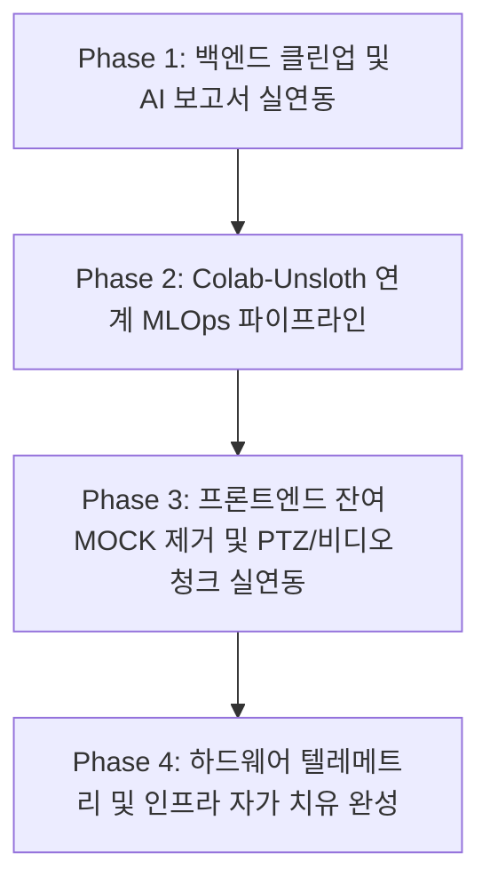

# ewVLM 시스템 추가 개발사항 정밀 분석 및 종합 개발 계획서

## 1. 개요 및 분석 배경
ewVLM 프로젝트는 실시간 영상 관제(VMS), WebRTC/MJPEG 듀얼 스트리밍, YOLOv11/VLM 엣지 추론, GIS 스마트맵, 사건 포렌식 등 핵심 도메인이 안정적으로 구동되는 단계에 도달했습니다.

최근 완료된 작업(Monitor A 조그/프리셋 연동, 4대 고도화 대시보드 구축, Fast-Loop 예외 안정화)에 이어, **완전한 상용화(Production-Ready)** 및 **실제 AI 모델 학습/서빙(Unsloth-Colab 연계 MLOps)**을 완성하기 위해 소스 코드 전수 조사 기반의 잔여 과제를 세밀하게 분석하고 실행 계획을 수립했습니다.

---

## 2. 도메인별 정밀 분석 및 추가 개발 과제

### [도메인 1] 백엔드 코어 & 데이터 정합성 (Backend Core)
| 구분 | 현황 및 분석 | 조치 및 개발 내용 | 중요도 |
| :--- | :--- | :--- | :---: |
| **레거시 MOCK 메모리 누수 방지** | `ewvlm_fastapi_gateway.py` 내 `DATABASE_MOCK` 전역 배열에 이벤트가 중복 append되는 잔재 존재 | SQLite DB (`models.py`) 단일 진실 공급원(SSOT)으로 일원화하고 `DATABASE_MOCK` 완전 제거 | **상** |
| **VSS 시맨틱 라우트 중복 정리** | `POST /api/v1/vss/search`가 키워드 Mock 라우트와 SentenceTransformer 실제 임베딩 라우트로 2개 존재 | 상단 레거시 라우트 제거 및 실제 벡터 유사도 검색 라우트로 단일화 | **상** |
| **AI 사건 보고서 자동 생성 실연동** | `/api/v1/events/{id}/report`가 고정 문자열(Hardcoded)을 반환 중 | `LMStudioVLMBridge`를 통해 실제 VLM(Llama 3.2 / Qwen)에 캡션과 메타데이터를 전달하여 정밀 상황 보고서 실시간 생성 | **중상** |
| **Active Learning 피드백 DB 저장** | 관제사의 오탐/정탐 피드백 API가 DB 업데이트 주석 처리 상태 | `feedback_logs` 테이블에 관제사 판정 및 바운딩박스/캡션 저장 파이프라인 구현 | **중상** |

---

### [도메인 2] AI & MLOps 파이프라인 (Vision AI & Finetuning)
*사용자의 Colab 환경(`unsloth`, `torchcodec`, `timm`, `transformers`) 준비와 직결되는 영역*

| 구분 | 현황 및 분석 | 조치 및 개발 내용 | 중요도 |
| :--- | :--- | :--- | :---: |
| **LoRA 학습용 데이터셋 자동 추출기** | 오탐/정탐 피드백 데이터를 Colab/Unsloth 학습 포맷으로 변환하는 기능 미비 | 관제 이벤트 이미지 + 프롬프트 + 정답 라벨을 **Unsloth Vision 포맷(JSONL + 이미지 패키징)**으로 원클릭 다운로드하는 API 개발 (`GET /api/v1/lora/export-dataset`) | **최상** |
| **학습 완료 가중치(LoRA Adapter) 핫 리로드** | Colab에서 학습된 LoRA 가중치를 Fast-Loop / Gateway에 즉시 반영하는 경로 부재 | `.safetensors` 또는 GGUF LoRA 어댑터를 업로드하면 재기동 없이 VLM 모델에 동적 마운트하는 엔드포인트 구축 | **상** |
| **자연어 룰(Rule) 생성 AI 코파일럿 연동** | `NaturalLanguageRuleCopilot.tsx`에서 규칙 생성 시 템플릿 기반 룰 매칭 상태 | 로컬 LLM/VLM에 사용자의 자연어("어린이가 차도에 진입하면 경보")를 전달하여 실제 유효한 JSON 관제 룰을 자동 생성하도록 연동 | **중** |

---

### [도메인 3] 프론트엔드 실기능 완성 (Frontend Refinement)
| 구분 | 현황 및 분석 | 조치 및 개발 내용 | 중요도 |
| :--- | :--- | :--- | :---: |
| **MonitorCanvas 디버깅 코드 정리** | 마우스 클릭 시 가짜 경보를 띄우는 `triggerMockAlert` 디버그 트리거 잔존 | 디버그 코드 제거 및 실제 백엔드 WebSocket 이벤트 수신 알림과 100% 동기화 | **중** |
| **PTZ 백엔드 실제 통신 바인딩** | `MonitorALiveControl` UI 상의 조그/틸트/줌 버튼이 UI 상태만 변경 중 | 백엔드의 ONVIF/SNMP PTZ 제어 엔드포인트 (`/api/v1/camera/{id}/ptz`)로 실제 Axios 요청 전송 | **상** |
| **포렌식 사건 리뷰 비디오 분절 재생** | `EventReviewCenter.tsx`에서 타임라인 클릭 시 실제 저장된 비디오 청크(MP4) 스트리밍 연동 필요 | 백엔드 저장 비디오 청크(`/api/v1/recordings/stream/{event_id}`)와 HTML5 비디오 플레이어 연결 | **중상** |
| **가상 워룸(DisasterVirtualWarRoom) SOP 실연동** | 비상 대응 3단계 발령 시 프론트 UI에서 백엔드 브로드캐스트 API 호출 연결 | 화재/침수/군중밀집 시 비상 방송, 출입 통제, SMS 발송 백엔드 트리거와 완벽 바인딩 | **중** |

---

### [도메인 4] 하드웨어 & 인프라 자가 치유 (Hardware & Infra)
| 구분 | 현황 및 분석 | 조치 및 개발 내용 | 중요도 |
| :--- | :--- | :--- | :---: |
| **NVR/서버 실제 리소스 텔레메트리** | `get_nvr_status` API에서 CPU/RAM 사용량을 난수(`_get_mock_stats`)로 생성 | `psutil` 라이브러리를 활용해 서버 실제 CPU, GPU(GTX 1660 SUPER VRAM), SSD 저장 공간을 실시간 수집 | **중** |
| **IP 오디오 방송(SIP/RTP) 실제 송출** | 오디오 콘솔에서 마이크 음성 또는 TTS 생성 시 백엔드 스트림 전달 체계 | 백엔드 FFmpeg 파이프를 통해 MediaMTX 또는 IP 스피커로 오디오 패킷 릴레이 | **중** |

---

## 3. 단계별 개발 실행 로드맵 (Execution Plan)

### 📍 [Phase 1] 백엔드 클린업 및 AI 실제 보고서 생성 (예상: 1차)
1. `ewvlm_fastapi_gateway.py` 내 레거시 `DATABASE_MOCK` 메모리 누수 요인 전면 제거
2. `POST /api/v1/vss/search` 중복 라우트 정리 (실제 임베딩 벡터 내적 계산 라우트 단일화)
3. `/api/v1/events/{id}/report` 호출 시 `LMStudioVLMBridge`를 활용해 Llama 3.2 모델 기반 실시간 상황 보고서 작성 연동
4. Active Learning 피드백(`POST /api/v1/events/{id}/feedback`)의 SQLite DB 영구 저장 로직 구현

### 📍 [Phase 2] Unsloth Colab 연계 MLOps 파이프라인 구축 (예상: 2차)
1. 백엔드에 관제 이벤트 피드백 기반 **Vision LoRA 학습 데이터셋 익스포터 (`GET /api/v1/lora/export-dataset`)** 구현
   - 구조: `{ "image": "base64/path", "conversations": [{"from": "human", "value": "..."}, {"from": "gpt", "value": "..."}] }`
2. 프론트엔드 `LoraFinetuningConsole.tsx`에 "Colab용 데이터셋 원클릭 다운로드" 버튼 및 학습 가이드 연동
3. Colab에서 파인튜닝 완료된 LoRA 가중치를 시스템에 업로드/적용하는 어댑터 로더 구축

### 📍 [Phase 3] 프론트엔드 잔여 MOCK 제거 및 실기능 바인딩 (예상: 3차)
1. `MonitorALiveControl.tsx`의 조그/팬틸트/줌 조작을 백엔드 `/api/v1/camera/{id}/ptz`와 실제 HTTP 통신 연결
2. `EventReviewCenter.tsx`의 타임라인 및 클립 뷰어를 백엔드 실제 녹화 청크(MP4) 재생 엔드포인트와 연결
3. `MonitorCanvas.tsx` 내 디버깅용 `triggerMockAlert` 완전 제거 및 순수 웹소켓 연동 보장
4. `NaturalLanguageRuleCopilot.tsx`의 자연어 룰 생성을 백엔드 LLM 엔진과 연결

### 📍 [Phase 4] 하드웨어 텔레메트리 및 인프라 실연동 (예상: 4차)
1. `psutil` 및 `pynvml`을 이용한 실시간 하드웨어(CPU, GPU VRAM, NVR 디스크) 모니터링 API 완성
2. `IpAudioBroadcastConsole.tsx`와 백엔드 TTS/오디오 릴레이 파이프라인 연결
3. 전체 시스템 통합 테스트 및 E2E 구동 안정성 최종 검증
