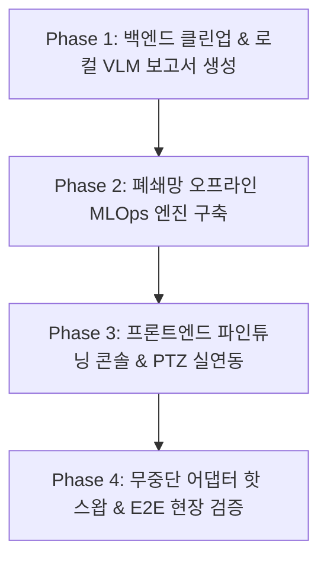

# ewVLM 폐쇄망(Air-Gapped) 자립형 MLOps & 시스템 완성 개발 계획서

## 1. 개요 및 폐쇄망 제약 조건 정의

ewVLM이 배치되는 관제 센터는 **외부 인터넷 접속이 차단된 완전 폐쇄망(Air-Gapped On-Premise)** 환경입니다.
따라서 Google Colab, Hugging Face Hub, 외부 클라우드 API(OpenAI/Claude 등)와 같은 외부 서비스와의 연동은 불가능하며, **데이터 수집부터 모델 파인튜닝, 가중치 평가, 실시간 추론 배포까지의 모든 MLOps 라이프사이클이 내부 인프라에서 100% 완결(Self-Contained)**되어야 합니다.

```
[기존 구상 (외부 의존)]
관제 이벤트 ──> 외부 추출 ──> Google Colab 파인튜닝 ──> 가중치 다운로드 (폐쇄망 불가 ❌)

[폐쇄망 자립형 아키텍처 (100% 로컬)]
[관제/피드백] ──> [로컬 Active Learning DB] ──> [오프라인 QLoRA 학습 엔진] ──> [LoRA 어댑터 핫 리로드]
      │                     │                              │                              │
  실시간 영상          로컬 스토리지 자동 축적        로컬 GPU/서버 배치 훈련         Fast-Loop/VLM 즉시 반영 (내부망 완결 ⭕)
```

---

## 2. 폐쇄망 전용 도메인별 핵심 개발 과제

### [도메인 1] 폐쇄망 로컬 Active Learning & 데이터셋 파이프라인
*외부 라벨링 툴 없이 관제사의 일상 업무 과정에서 학습 데이터가 자동으로 축적되는 체계*

| 개발 항목 | 상세 구현 내용 | 산출물 / 엔드포인트 | 중요도 |
| :--- | :--- | :--- | :---: |
| **관제 피드백 실시간 적재** | 관제사가 화면에서 수행하는 오탐(False Positive)/정탐(True Positive) 피드백 및 바운딩박스 수정을 로컬 DB에 영구 기록 | `POST /api/v1/events/{id}/feedback`<br>`feedback_logs` 테이블 | **최상** |
| **폐쇄망 데이터셋 자동 빌더** | 축적된 피드백을 기반으로 로컬 디렉터리에 Vision VLM(PaliGemma/Llama-Vision) 파인튜닝용 정형 데이터셋(`train.jsonl`, `val.jsonl`, 이미지 청크)을 자동 추출/분할 | `GET /api/v1/lora/local-dataset/build`<br>`/data/finetune_dataset/` | **최상** |
| **로컬 데이터 증강 및 정제** | 폐쇄망 내부 데이터 부족 현상(Data Scarcity)을 극복하기 위해 OpenCV 기반 기하 변환, 노이즈, 조도 변화 오프라인 증강 파이프라인 구현 | `backend/mlops/dataset_augmenter.py` | **상** |

---

### [도메인 2] 오프라인 QLoRA 파인튜닝 엔진 (Local Training Engine)
*인터넷 다운로드 없이 로컬에 캐시된 가중치와 하드웨어 환경(BitsAndBytes 4-bit)으로만 구동*

| 개발 항목 | 상세 구현 내용 | 산출물 / 엔드포인트 | 중요도 |
| :--- | :--- | :--- | :---: |
| **오프라인 학습 스크립트 구축** | Hugging Face Hub 통신을 전면 차단하고 `local_files_only=True`로 로컬 모델 가중치(`weights/`, `models/`)를 직접 로드하여 학습하는 독립 실행형 파이프라인 | `backend/mlops/train_lora_local.py`<br>(PEFT + BitsAndBytes QLoRA) | **최상** |
| **학습 라이프사이클 비동기 매니저** | FastAPI 백그라운드 태스크로 학습 프로세스를 서브프로세스로 격리 구동하고, 시작/중지/일시정지 제어 | `POST /api/v1/lora/train/start`<br>`POST /api/v1/lora/train/stop` | **상** |
| **실시간 학습 텔레메트리 웹소켓** | 학습 진행 상황(Epoch, Step, Current Loss, ETA, VRAM 점유율)을 실시간으로 수집하여 프론트엔드로 브로드캐스트 | WebSocket: `/ws/lora/telemetry`<br>`backend/mlops/training_monitor.py` | **상** |
| **가중치 어댑터 무중단 핫 리로드** | 학습이 완료되면 생성된 LoRA 어댑터(`.safetensors`)를 Fast-Loop 및 게이트웨이 VLM 인스턴스에 재기동 없이 즉시 교체/적용 | `POST /api/v1/lora/adapters/activate`<br>`adapter_manager.py` | **최상** |

---

### [도메인 3] 백엔드 코어 클린업 & 로컬 VLM 연동
| 개발 항목 | 상세 구현 내용 | 중요도 |
| :--- | :--- | :---: |
| **`DATABASE_MOCK` 메모리 누수 잔재 제거** | `ewvlm_fastapi_gateway.py` 내 남아있는 레거시 `DATABASE_MOCK` 전역 배열 완전 제거, SQLite 단일 진실 공급원(SSOT) 확립 | **최상** |
| **VSS 시맨틱 라우트 중복 정리** | 상단의 Mock 라우트를 제거하고, 로컬 임베딩 모델 기반의 실제 벡터 유사도 검색 라우트로 일원화 | **상** |
| **로컬 VLM 기반 실시간 AI 사건 보고서** | `/api/v1/events/{id}/report` 호출 시 하드코딩 문자열을 제거하고, 로컬 PaliGemma/Llama-Vision 모델을 호출하여 전문 관제 상황 보고서 자동 생성 | **상** |

---

### [도메인 4] 프론트엔드 콘솔 실연동 (UI/UX)
| 개발 항목 | 상세 구현 내용 | 대상 컴포넌트 | 중요도 |
| :--- | :--- | :--- | :---: |
| **로컬 파인튜닝 대시보드 연동** | 하이퍼파라미터(Batch Size, LoRA Rank, LR, Epoch) 입력, 학습 시작/중단 버튼, 실시간 Loss 커브 그래프 렌더링 | `LoraFinetuningConsole.tsx` | **최상** |
| **PTZ 실제 제어 통신 바인딩** | 조그 다이얼/방향키 조작 시 백엔드 `/api/v1/camera/{id}/ptz`로 실제 Axios 제어 패킷 전송 | `MonitorALiveControl.tsx` | **상** |
| **포렌식 사건 리뷰 비디오 청크 스트리밍** | 타임라인 클릭 시 로컬 스토리지에 분절 저장된 MP4 청크 파일 스트리밍 연동 | `EventReviewCenter.tsx` | **중상** |
| **MonitorCanvas 디버그 잔재 정리** | 마우스 클릭 시 가짜 경보를 띄우는 `triggerMockAlert` 디버그 함수 제거 | `MonitorCanvas.tsx` | **중** |

---

## 3. 폐쇄망 개발 로드맵 (Phase 1 ~ Phase 4)



### 📍 [Phase 1] 백엔드 코어 정비 및 로컬 VLM 보고서 연동
1. `ewvlm_fastapi_gateway.py`의 `DATABASE_MOCK` 레거시 배열 및 관련 중복 코드 완전 제거
2. `POST /api/v1/vss/search` 중복 라우트 정리 (로컬 임베딩 기반 단일화)
3. 로컬 VLM 모델을 통한 실시간 사건 보고서 생성 (`/api/v1/events/{id}/report`) 구현
4. 관제사 피드백 데이터 영구 적재 테이블(`feedback_logs`) 생성 및 API 연결

### 📍 [Phase 2] 폐쇄망 전용 오프라인 QLoRA 학습 파이프라인 개발
1. **로컬 데이터셋 빌더 (`dataset_builder.py`)**: 로컬 DB 피드백을 Vision LoRA 포맷(JSONL + 이미지)으로 자동 덤프
2. **오프라인 학습 스크립트 (`train_lora_local.py`)**: `local_files_only=True` 기반 BitsAndBytes 4-bit QLoRA 파이프라인 개발
3. **학습 제어 및 텔레메트리 API**:
   - `POST /api/v1/lora/train/start` (백그라운드 비동기 프로세스 시작)
   - `POST /api/v1/lora/train/stop` (안전 중단)
   - `GET /api/v1/lora/telemetry` & WebSocket (실시간 Loss, Epoch, VRAM 스트리밍)

### 📍 [Phase 3] 프론트엔드 파인튜닝 콘솔 & 잔여 UI 실연동
1. `LoraFinetuningConsole.tsx`:
   - 로컬 학습 데이터셋 현황(라벨링 건수) 실시간 조회
   - 학습 시작/중단 트리거 및 실시간 Loss 차트 연동
   - 학습 완료된 어댑터 목록 표출 및 "운영 모델로 즉시 적용" 버튼 활성화
2. `MonitorALiveControl.tsx`: PTZ 조그/프리셋 조작과 백엔드 `/api/v1/camera/{id}/ptz` 실제 통신 연결
3. `EventReviewCenter.tsx`: 사건 포렌식 타임라인 클릭 시 실제 분절 MP4 비디오 재생 연동
4. `MonitorCanvas.tsx`: 디버깅용 `triggerMockAlert` 완전 제거

### 📍 [Phase 4] 어댑터 무중단 핫 리로드 & 폐쇄망 통합 테스트
1. 학습된 LoRA 가중치를 VLM 추론 엔진에 서버 재시작 없이 동적 로드/교체하는 `adapter_manager.py` 구현
2. 전체 서비스(`FastAPI Gateway`, `YOLO Fast-Loop`, `React Frontend`) 간 폐쇄망 E2E 파이프라인 통합 테스트 수행
3. 폐쇄망 운영용 자동 기동 스크립트(`run_ewvlm_all.bat`) 및 오프라인 환경 매뉴얼 업데이트
