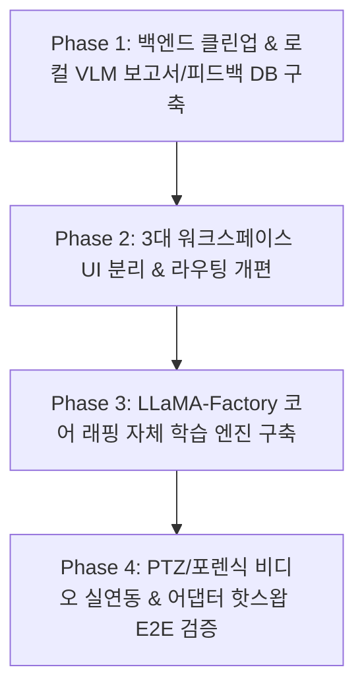

# ewVLM 폐쇄망 자체 로컬 MLOps 및 3대 독립 워크스페이스 개편 종합 개발 계획서

## 1. 핵심 설계 변경 사항 (최신 의사결정 반영)

### ① 로컬 파인튜닝 엔진 체계 확정 (LLaMA-Factory 코어 내장)
* **결정 사항**: 외부 통신(Colab/인터넷) 0%의 완전 폐쇄망을 위해, 이미 로컬 시스템(`Python 3.13`)에 설치된 **`LLaMA-Factory (v0.9.6.dev0)`를 코어 엔진으로 캡슐화**합니다.
* **사전 준비 사항 (오프라인 자산)**:
  * 로컬 디렉터리(`e:\projects\ewVLM\models\base_models\`)에 베이스 모델 가중치(PaliGemma-3B / Llama-3.2-Vision 등)를 사전 배치.
  * `HF_HUB_OFFLINE=1` 및 `local_files_only=True` 플래그로 100% 오프라인 구동.
  * 현 하드웨어(`GTX 1660 SUPER 6GB`) 맞춤형 **4-bit QLoRA + Gradient Checkpointing** 자동 적용.

### ② 화면 도메인 전면 분리 (3대 독립 워크스페이스 체계 구축)
* **결정 사항**: **실시간 관제(1초가 급한 현장 업무)**와 **AI 모델 학습(GPU를 100% 점유하는 고부하 배치 작업)**이 동일 화면/탭에 섞여 발생하는 관제사의 조작 혼선 및 시스템 부하를 방지하기 위해, 상단 글로벌 네비게이션을 **3대 독립 도메인**으로 완전히 분리합니다.

```
┌─────────────────────────────────────────────────────────────────────────────────────────────┐
│                                 ewVLM 글로벌 상단 네비게이션                                │
├──────────────────────────────┬──────────────────────────────┬───────────────────────────────┤
│    [1. Monitor A]            │    [2. Monitor B]            │    [3. AI MLOps 스튜디오]     │
│    현장 실시간 관제/제어     │    VLM 지능형 사건 포렌식    │    폐쇄망 자체 모델 학습 센터 │
├──────────────────────────────┼──────────────────────────────┼───────────────────────────────┤
│ • 16분할 실시간 CCTV (WebRTC)│ • VLM 심층 사건 분석         │ • 로컬 데이터셋 관리 & 검증   │
│ • PTZ 조그 / 방향키 제어     │ • 가상 재난 워룸 (SOP)       │ • LLaMA-Factory 4-bit LoRA학습│
│ • 비상 IP 오디오 방송        │ • 사건 타임라인 및 클립 재생 │ • 실시간 Loss/VRAM 모니터링   │
│ • 긴급 알림 센터 (Alert)     │ • 실시간 BI 통계 대시보드    │ • LoRA 어댑터 무중단 핫배포   │
│ • 다채널 동기화 플레이백     │ • 자연어 시맨틱 검색 (VSS)   │ • 프롬프트 템플릿 관리        │
│ ➔ [주 사용자: 현장 관제사]   │ ➔ [주 사용자: 상황실장/조사관]│ ➔ [주 사용자: AI/시스템 관리자│
└──────────────────────────────┴──────────────────────────────┴───────────────────────────────┘
```

---

## 2. 도메인별 세부 개발 명세

### [워크스페이스 1] Monitor A: 현장 실시간 관제 도메인 (Operator)
* **화면 분리 조치**: 실시간 감시와 하드웨어 제어에만 집중하도록 MLOps 관련 메뉴를 완전히 제거하고 관제 기능 순도 극대화.
* **주요 개발 내용**:
  * `MonitorALiveControl.tsx`: 조그 다이얼/방향키 조작 시 백엔드 `/api/v1/camera/{id}/ptz`로 실제 Axios 제어 패킷 전송.
  * `MonitorCanvas.tsx`: 마우스 클릭 시 가짜 경보를 띄우는 디버그 코드(`triggerMockAlert`) 완전 제거, 백엔드 웹소켓 실시간 이벤트와 100% 동기화.
  * `AlertCenterDashboard.tsx`: 실제 이벤트 스토어 및 Fast-Loop 실시간 스냅샷 뷰포트 연동 유지.

### [워크스페이스 2] Monitor B: VLM 지능형 사건 포렌식 도메인 (Investigator)
* **화면 분리 조치**: 사건 조사 및 재난 대응에 집중하도록 LoRA 파인튜닝 메뉴를 MLOps 스튜디오로 이관.
* **주요 개발 내용**:
  * `EventReviewCenter.tsx`: 사건 포렌식 타임라인 클릭 시 실제 분절 저장된 MP4 비디오 청크 스트리밍 재생 연동.
  * `DisasterVirtualWarRoom.tsx`: 비상 대응 발령 시 백엔드 SOP 브로드캐스트 API 호출 연결.
  * **진짜 AI 사건 보고서 연동**: `/api/v1/events/{id}/report` 호출 시 로컬 VLM을 호출하여 정밀 상황 보고서 실시간 생성.

### [워크스페이스 3] AI MLOps 스튜디오: 폐쇄망 자체 로컬 학습 센터 (MLOps Admin)
* **신규 독립 워크스페이스 구축**: `App.tsx` 및 사이드바 레이아웃에 `MlOpsLayout` 신설.
* **구성 화면**:
  1. `DatasetManagementPortal.tsx` (신규/개편):
     * 관제 화면에서 수집된 오탐/정탐 피드백 데이터 조회 및 필터링
     * LLaMA-Factory 표준 Vision 포맷(`dataset_info.json` + `data.jsonl`)으로 원클릭 빌드
  2. `LoraFinetuningConsole.tsx` (개편):
     * 하이퍼파라미터 설정 (LoRA Rank, Alpha, Learning Rate, Batch Size=1, Epoch)
     * LLaMA-Factory 4-bit QLoRA 비동기 학습 시작/중단 제어
     * 웹소켓 기반 실시간 Loss 커브 그래프 및 VRAM/온도 모니터링
  3. `ModelAdapterDeploy.tsx` (신규/개편):
     * 학습 완료된 LoRA 어댑터 목록 관리 및 성능 지표(Evaluation Loss) 확인
     * **"운영 VLM으로 즉시 핫 리로드(Hot-Swap)"** 버튼 클릭 시 재시작 없이 가중치 교체
  4. `PromptGatewayDeploy.tsx` / `SemanticVectorPortal.tsx`:
     * 프롬프트 템플릿 관리 및 2D t-SNE 시맨틱 벡터 분포 시각화

### [백엔드 코어] 시스템 클린업 & 로컬 MLOps 엔진 레이어
1. **`DATABASE_MOCK` 메모리 누수 잔재 제거**: `ewvlm_fastapi_gateway.py` 내 전역 배열 삭제 및 SQLite SSOT 확립.
2. **중복 VSS 라우트 단일화**: 상단 Mock 라우트를 제거하고 실제 로컬 벡터 임베딩 유사도 검색 라우트로 통합.
3. **`backend/mlops/` 모듈 신설**:
   * `dataset_orchestrator.py`: DB 피드백 ➔ LLaMA-Factory 포맷 자동 변환기
   * `inhouse_train_engine.py`: LLaMA-Factory 0.9.6 4-bit QLoRA 비동기 구동 워커
   * `telemetry_bridge.py`: 실시간 훈련 통계 웹소켓 스트리밍
   * `adapter_manager.py`: VLM 인스턴스 LoRA 어댑터 무중단 동적 마운트

---

## 3. 4단계 개발 실행 계획 (Execution Roadmap)



### 📍 [Phase 1] 백엔드 코어 정비 & 로컬 VLM 연동
* `ewvlm_fastapi_gateway.py` 잔여 `DATABASE_MOCK` 코드 및 중복 VSS 라우트 제거
* 로컬 VLM 모델 기반 실시간 AI 사건 보고서 생성 API 구현 (`/api/v1/events/{id}/report`)
* 관제사 오탐/정탐 피드백 데이터 영구 적재용 `feedback_logs` 테이블 구축 및 API 연결

### 📍 [Phase 2] 프론트엔드 3대 독립 워크스페이스 분리 & 라우팅 개편
* 글로벌 네비게이션 헤더 개편: `[Monitor A]` / `[Monitor B]` / `[AI MLOps 스튜디오]` / `[설정]`
* `App.tsx`에 `MlOpsLayout`을 신설하여 학습/데이터셋 관련 화면들을 독립 라우트로 격리
* `MonitorCanvas.tsx` 내 디버깅용 `triggerMockAlert` 완전 제거

### 📍 [Phase 3] LLaMA-Factory 기반 폐쇄망 자체 학습 엔진 구현
* `dataset_orchestrator.py`: 피드백 데이터 ➔ LLaMA-Factory Vision 데이터셋 자동 빌더
* `inhouse_train_engine.py`: 설치된 LLaMA-Factory 0.9.6 기반 오프라인 4-bit QLoRA 비동기 훈련 워커 개발
* `telemetry_bridge.py`: 웹소켓(`/ws/lora/telemetry`) 기반 실시간 Loss/VRAM 스트리밍
* `LoraFinetuningConsole.tsx`와 백엔드 학습 엔진 완전 바인딩

### 📍 [Phase 4] 하드웨어 실연동 & LoRA 어댑터 무중단 핫 리로드 E2E 검증
* `MonitorALiveControl.tsx`: PTZ 조그/방향키 조작 시 실제 백엔드 `/api/v1/camera/{id}/ptz` 제어 통신 연결
* `EventReviewCenter.tsx`: 포렌식 타임라인 클릭 시 실제 분절 MP4 비디오 스트리밍 연결
* `adapter_manager.py`: 학습 완료된 어댑터를 VMS 재부팅 없이 즉시 스왑/적용하는 파이프라인 검증
* 폐쇄망 오프라인 환경 통합 테스트 및 최종 산출물 정리
